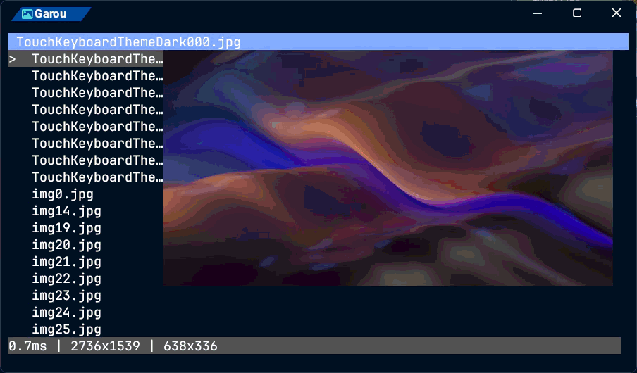

# Garou(がろう) - Simple Image Protocol Viewer for Kitty Graphics Protocol
**[日本語](README/README-ja.md) / English**
```bash
siv
```
***TUI image viewer using the Kitty Graphics Protocol***



## ⭐ Features
- **LRU Caching**: Memory-efficient image management
- **Debounce Control**: Optimized preview updates on cursor movement
- **Natural Sort**: File names are listed in the order 1, 2, 3, 10, 11, 12
- **Mouse Control**: Zoom with the wheel, pan by dragging

## 💻 System Requirements
### OS
#### Verified
- [x] Windows 11 (64bit)
- [x] Linux
#### Unverified
- [ ] Mac
### Terminal Emulator
A **terminal emulator that supports the Kitty Graphics Protocol** is required.
#### Verified
- [x] Wezterm Nightly
- [x] Ghostty 1.4.0
#### Not Working
- Windows Terminal

## 📦 Installation
### cargo
#### `cargo install`
```bash
cargo install garou
```
#### `cargo binstall`
```bash
cargo binstall garou
```
#### `cargo install --git`
```bash
cargo install --git https://github.com/c0b23092db/garou
```

## 📖 Commands
```
> siv --help
TUI: Simple Image Protocol Viewer for Kitty Graphics Protocol

Usage: siv.exe [PATH]

Arguments:
  [PATH]  Open Image file or Directory [defaults: current directory]

Options:
  -h, --help     Print help
  -V, --version  Print version
```

## ⚙️ Configuration File
Reads `~/.config/garou/config.toml`.
Write only the settings you want to change; everything else keeps its default.
The TOML below shows the default settings ([`config/config.toml`](config/config.toml), embedded in the binary).

```toml
[image]
extensions = ["png", "jpg", "jpeg", "gif", "webp", "bmp"]
transport_mode = "auto"
filter_type = "Nearest"
image_width = 5120
image_height = 2880
diff_mode = "All"
dirty_ratio = 0.1
tile_grid = 32
skip_step = 1

[display]
sidebar = true
header = true
statusbar = true
sidebar_size = 20
preview_debounce = 100  # Preview update debounce (milliseconds)
poll_interval = 10      # Idle polling interval (milliseconds)
prefetch_interval = 100 # Idle prefetch interval (milliseconds)
header_bg_color = "dark_blue"    # Header background color
header_fg_color = "white"        # Header text color
statusbar_bg_color = "dark_gray" # Statusbar background color
statusbar_fg_color = "white"     # Statusbar text color

[cache]
lru_size = 10         # Maximum number of LRU cache entries
prefetch_size = 1     # Number of prefetched images
max_bytes = 268435456 # Total cache size limit (bytes)
```

### **image**

#### transport_mode: Kitty Graphics Protocol transfer mode
- `auto`
- `direct` (`d`)
- `file` (`f`)
- `temp_file` (`t`)
- `shared_memory` (`s`)

##### `auto` behavior
- Linux: `shared_memory` -> `direct`
- Windows: `direct`

#### image_width, image_height: Maximum size when rendering via `file` etc.
The maximum size of an image rendered when transport_mode is `file`, `temp_file`, or `shared_memory`. Images larger than this fall back to `direct`.
By default, images up to 5K can be loaded.

#### filter_type: Image decode filter
The decode filter used when transport_mode is `direct`.
See [image::imageops::FilterType](https://docs.rs/image/latest/image/imageops/enum.FilterType.html) in the image crate for details.
- `Nearest`
- `Triangle`
- `CatmullRom`
- `Gaussian`
- `Lanczos3`

#### diff_mode: Image display process
- `All`: No difference check; the image is refreshed every time
- `Full`: Checks every RGB (FFFFFF) address and updates only when something changed
- `Half`: Checks only RGB (FFFFFF) addresses 0, 2, and 4

#### dirty_ratio: Difference threshold
The threshold for deciding whether a region has changed. Accepts 0.0 to 1.0.

#### tile_grid: Difference check tile
The side length, in pixels, of the tiles used for change detection.

#### skip_step: Pixel skipping
Scans pixels at the given interval.

### **display**

#### sidebar, header, statusbar: Shown at startup
Whether each panel is open or closed at startup.
- sidebar
- header
- statusbar

#### color
The following colors are available:
- black
- dark_gray
- gray
- white
- red
- dark_red
- green
- dark_green
- yellow
- dark_yellow
- blue
- dark_blue
- magenta
- dark_magenta
- cyan
- dark_cyan
- #RRGGBB (e.g. #1E90FF)
- rgb(r,g,b) (e.g. rgb(30,144,255))

#### preview_debounce: Preview update debounce
The debounce time during user input, in milliseconds.

#### poll_interval: Idle polling interval
The maximum wait time before checking for keyboard or mouse input, in milliseconds.

#### prefetch_interval: Idle prefetch interval
The minimum interval for prefetching adjacent images while idle, in milliseconds.

### **cache**

#### max_bytes: Image cache capacity
The default is **268435456** (256MB, `256 * 1024 * 1024`).

## 🔭 Recommended Settings
### Local
```toml
[image]
diff_mode = "All"
transport_mode = "file"

[display]
header = true
sidebar = true
statusbar = false
sidebar_size = 20
preview_debounce = 50

[cache]
lru_size = 5
prefetch_size = 1
```

## ⌨️ Controls
Key bindings can be changed in `~/.config/garou/keymap.toml`.
Write only the actions you want to change; each entry replaces that action's default keys.
The TOML below shows the default settings ([`config/keymap.toml`](config/keymap.toml), embedded in the binary).

```toml
# ---- General ----
quit = ["q", "esc"]                # Quit
open = ["o", "O"]                  # Open with the default app
refresh_image = ["r"]              # Re-send the image
refresh_screen = ["R"]             # Redraw the whole screen
toggle_sidebar = ["alt+s", "alt+S"]   # Toggle sidebar
toggle_statusbar = ["alt+d", "alt+D"] # Toggle statusbar
toggle_header = ["alt+f", "alt+F"]    # Toggle header
toggle_overlay = ["tab"]           # Toggle image info overlay

# ---- Navigation ----
# Sidebar shown: prev / next collapse / expand the folder
# Sidebar hidden: previous / next image (wraps around at the ends)
prev = ["h", "left"]
next = ["l", "right"]
up = ["k", "up"]                   # Move sidebar cursor up (sidebar shown only)
down = ["j", "down"]               # Move sidebar cursor down (sidebar shown only)
page_up = ["ctrl+b"]               # Up one page
page_down = ["ctrl+f"]             # Down one page
first = ["g"]                      # Go to first
last = ["G"]                       # Go to last
toggle_dir = ["enter"]             # Toggle folder (sidebar shown only)

# ---- Zoom / Pan ----
zoom_in = ["+", "="]               # Zoom in
zoom_out = ["-"]                   # Zoom out
zoom_fit = ["0"]                   # Fit to screen
pan_left = ["H"]                   # Pan view left (while zoomed in)
pan_right = ["L"]                  # Pan view right (while zoomed in)
pan_up = ["K"]                     # Pan view up (while zoomed in)
pan_down = ["J"]                   # Pan view down (while zoomed in)

# ---- Sort (uppercase = descending) ----
sort_natural = ["n"]               # Name (natural order: 1, 2, 10)
sort_natural_desc = ["N"]
sort_modified = ["m"]              # Modified time
sort_modified_desc = ["M"]
sort_size = ["s"]                  # File size
sort_size_desc = ["S"]

# ---- File Operations ----
delete = ["d"]                     # Move to trash (confirm with y)
rename = ["f2"]                    # Rename (Enter to confirm / Esc to cancel)
```

### General
- `Q / esc`: Quit
- `O`: Open with the default program
- `R`: Refresh image
- `Shift + R`: Refresh screen
- `Alt + S`: Toggle sidebar
- `Alt + D`: Toggle statusbar
- `Alt + F`: Toggle header

### Image Display
- `H / ←`: Previous image
- `L / →`: Next image

### Image Manipulation
- `0`: Fit image
- `+`: Zoom in
- `-`: Zoom out
- `Shift + J`, `Shift + K`, `Shift + H`, `Shift + L`: Pan image
- `Drag`: Pan image
- `Wheel`: Zoom in / out

### Sidebar
- `J / ↓`: Move cursor down
- `K / ↑`: Move cursor up
- `G`: Move to top
- `Shift + G`: Move to bottom
- `Ctrl + B`: Move up one page
- `Ctrl + F`: Move down one page
- `H / ←`: Collapse folder
- `L / →`: Expand folder
- `Enter`: Toggle folder
- `Left Click`: Select file
- `Wheel`: Move cursor

## 💡 Inspiration
- [Kitty Graphic Protocol](https://sw.kovidgoyal.net/kitty/): Image rendering in the terminal
- [yazi](https://github.com/sxyazi/yazi): Fast image preview
- [Neovim](https://neovim.io): Keyboard-driven operation

## 🤝 Contributing
Bug reports, feature suggestions, and pull requests are welcome.

## 📜 LICENSE
[MIT License](LICENSE) / <http://opensource.org/licenses/MIT>
