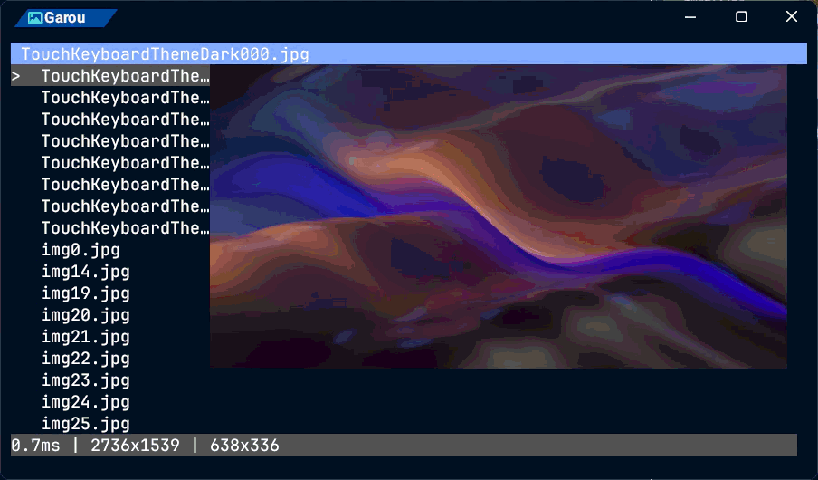

# Garou(がろう) - Simple Image Protocol Viewer for Kitty Graphics Protocol
**日本語 / [English.md](../README.md)**
```bash
siv
```
***Kitty Graphics Protocolを使用したTUIの画像表示***



## ⭐ 特徴
- **LRUキャッシング**: メモリ効率的な画像管理
- **デバウンス制御**: カーソル移動時のプレビュー更新を最適化
- **自然ソート**: ファイル名を1,2,3,10,11,12の順序で表示
- **マウス操作**: ホイールで画像の拡大縮小、ドラッグで画像の移動

## 💻 実行環境
### OS
#### 検証済
- [x] Windows 11(64bit)
#### 未検証
- [ ] Linux
- [ ] Mac
### ターミナルエミュレータ
**Kitty Graphics Protocolが動作するターミナルエミュレータ**が必要です。
#### 検証済
- [x] Wezterm Nightly
#### 動作不能
- Windows Terminal

## 📦 インストール
### cargo
#### `cargo install`
```bash
cargo install garou
```
#### `cargo binstall`
```bash
cargo binstall garou
```
#### `cargo install --git`
```bash
cargo install --git https://github.com/c0b23092db/garou
```

## 📖 コマンド
```
> siv --help
TUI: Simple Image Protocol Viewer for Kitty Graphics Protocol

Usage: siv.exe [PATH]

Arguments:
  [PATH]  Open Image file or Directory [defaults: current directory]

Options:
  -h, --help     Print help
  -V, --version  Print version
```

## ⚙️ 設定ファイル
`~/.config/garou/config.toml`を読み込みます。
変えたい項目だけを書けば、書かなかった項目は既定値のままです。
以下のTOMLはデフォルト設定です（[`config/config.toml`](../config/config.toml)、バイナリに埋め込み）。

```toml
[image]
extensions = ["png", "jpg", "jpeg", "gif", "webp", "bmp"]
transport_mode = "auto"
filter_type = "Nearest"
image_width = 5120
image_height = 2880
diff_mode = "All"
dirty_ratio = 0.1
tile_grid = 32
skip_step = 1

[display]
sidebar = true
header = true
statusbar = true
sidebar_size = 20
preview_debounce = 100  # プレビュー更新のデバウンス（ミリ秒）
poll_interval = 10      # アイドル状態のポーリング間隔（ミリ秒）
prefetch_interval = 100 # アイドル状態の先読み間隔（ミリ秒）
header_bg_color = "dark_blue"    # ヘッダー背景色
header_fg_color = "white"        # ヘッダー文字色
statusbar_bg_color = "dark_gray" # ステータスバー背景色
statusbar_fg_color = "white"     # ステータスバー文字色

[cache]
lru_size = 10         # LRUキャッシュ最大数
prefetch_size = 1     # 先読みキャッシュ数
max_bytes = 268435456 # キャッシュ総容量上限（バイト）
```

### **image**

#### transport_mode: Kitty Graphics Protocolの転送モード
- `auto`
- `direct` (`d`)
- `file` (`f`)
- `temp_file` (`t`)
- `shared_memory` (`s`)

##### autoの挙動
- Linux: `shared_memory` -> `direct`
- Windows: `direct`

#### image_width, image_height: `file`などによる描画時の最大サイズ
transport_modeが`file`,`temp_file`,`shared_memory`の時、描画する画像の最大サイズです。これを超える画像を読み込んだ場合、`direct`としてフォールバックします。
デフォルトで5Kの画像まで読み込めます。

#### filter_type: 画像のデコード処理
transport_modeが`direct`の時に行うデコード処理です。
詳しくはimageクレートの[image::imageops::FilterType](https://docs.rs/image/latest/image/imageops/enum.FilterType.html)を参照してください。
- `Nearest`
- `Triangle`
- `CatmullRom`
- `Gaussian`
- `Lanczos3`

#### diff_mode: 画像表示プロセス
- `All`: 差分判定を行わず、毎回画像をリフレッシュする
- `Full`: RGB（FFFFFF）のすべての番地を判定して変更がある場合のみ更新する
- `Half`: RGB（FFFFFF）の0番地、2番地、4番地のみ判定する

#### dirty_ratio: 差分判定の閾値
差分かどうかを判定する閾値です。0.0~1.0が設定できます。

#### tile_grid: 差分判定タイル
変化判定に使うタイルの1辺ピクセル数です。

#### skip_step: 画素間引き
指定したピクセル間隔で走査します。

### **display**

#### sidebar, header, statusbar: 起動時展開
起動時に開閉状態にする設定です。
- sidebar
- header
- statusbar

#### color
以下の色が選べます。
- black
- dark_gray
- gray
- white
- red
- dark_red
- green
- dark_green
- yellow
- dark_yellow
- blue
- dark_blue
- magenta
- dark_magenta
- cyan
- dark_cyan
- #RRGGBB（例: #1E90FF）
- rgb(r,g,b)（例: rgb(30,144,255)）

#### preview_debounce: プレビュー更新のデバウンス
操作時のデバウンス時間をミリ秒で指定する。

#### poll_interval: アイドル状態のポーリング間隔
ユーザーのキーボードやマウス操作をチェックするまでの最大待機時間をミリ秒で指定する。

#### prefetch_interval: アイドル状態の先読み間隔
アイドル状態で隣の画像をプリフェッチする最小実行間隔をミリ秒で指定する。

### **cache**

#### max_bytes: 画像キャッシュの容量
`256 * 1024 * 1024`の**268435456**(256MB)がデフォルト値となっています。

## 🔭 おすすめ設定
### Local
```toml
[image]
diff_mode = "All"
transport_mode = "file"

[display]
header = true
sidebar = true
statusbar = false
sidebar_size = 20
preview_debounce = 50

[cache]
lru_size = 5
prefetch_size = 1
```

## ⌨️ 操作
操作方法は`~/.config/garou/keymap.toml`で変更できます。
変えたい動作だけを書けば、その動作の既定キーが置き換わります。
以下のTOMLはデフォルト設定です（[`config/keymap.toml`](../config/keymap.toml)、バイナリに埋め込み）。

```toml
# ---- 全般 ----
quit = ["q", "esc"]                # 終了
open = ["o", "O"]                  # 既定のアプリで開く
refresh_image = ["r"]              # 画像を再転送
refresh_screen = ["R"]             # 画面全体を再描画
toggle_sidebar = ["alt+s", "alt+S"]   # サイドバー表示切替
toggle_statusbar = ["alt+d", "alt+D"] # ステータスバー表示切替
toggle_header = ["alt+f", "alt+F"]    # ヘッダー表示切替
toggle_overlay = ["tab"]           # 画像情報オーバーレイ表示切替

# ---- 移動 ----
# サイドバー表示中: prev / next はフォルダを閉じる / 開く
# サイドバー非表示: 前 / 次の画像（端で反対側へ回る）
prev = ["h", "left"]
next = ["l", "right"]
up = ["k", "up"]                   # サイドバーのカーソルを上へ（表示中のみ）
down = ["j", "down"]               # サイドバーのカーソルを下へ（表示中のみ）
page_up = ["ctrl+b"]               # 1ページ上へ
page_down = ["ctrl+f"]             # 1ページ下へ
first = ["g"]                      # 先頭へ
last = ["G"]                       # 末尾へ
toggle_dir = ["enter"]             # フォルダ開閉（サイドバー表示中のみ）

# ---- ズーム・パン ----
zoom_in = ["+", "="]               # 拡大
zoom_out = ["-"]                   # 縮小
zoom_fit = ["0"]                   # 画面に合わせる
pan_left = ["H"]                   # 表示範囲を左へ（拡大中）
pan_right = ["L"]                  # 表示範囲を右へ（拡大中）
pan_up = ["K"]                     # 表示範囲を上へ（拡大中）
pan_down = ["J"]                   # 表示範囲を下へ（拡大中）

# ---- 並べ替え（大文字は降順） ----
sort_natural = ["n"]               # 名前（自然順: 1, 2, 10）
sort_natural_desc = ["N"]
sort_modified = ["m"]              # 更新日時
sort_modified_desc = ["M"]
sort_size = ["s"]                  # ファイルサイズ
sort_size_desc = ["S"]

# ---- ファイル操作 ----
delete = ["d"]                     # ごみ箱へ移動（y で確定）
rename = ["f2"]                    # 名前を変更（Enter で確定 / Esc で取消）
```

### 全般
- `Q / esc`: 終了
- `O`: デフォルトプログラムで開く
- `R`: 画像のリフレッシュ
- `Shift + R`: 画面のリフレッシュ
- `Alt + S`: サイドバーの切り替え
- `Alt + D`: ステータスバーの切り替え
- `Alt + F`: ヘッダーの切り替え

### 画像表示
- `H / ←`: 前の画像へ移動
- `L / →`: 次の画像へ移動

### 画像操作
- `0`: 画像のフィット
- `+`: 画像の拡大
- `-`: 画像の縮小
- `Shift + J`, `Shift + K`, `Shift + H`, `Shift + L`: 画像の移動
- `ドラッグ`: 画像の移動
- `ホイール`: 画像の拡大/縮小

### サイドバー
- `J / ↓`: カーソルを下に移動
- `K / ↑`: カーソルを上に移動
- `G`: 一番上に移動
- `Shift + G`: 一番下に移動
- `Ctrl + B`: 一ページ上に移動
- `Ctrl + F`: 一ページ下に移動
- `H / ←`: フォルダを折りたたむ
- `L / →`: フォルダを展開
- `Enter`: フォルダのトグル
- `左クリック`: ファイルを選択
- `ホイール`: カーソルを移動

## 💡 着想
- [Kitty Graphic Protocol](https://sw.kovidgoyal.net/kitty/): ターミナルでの画像表示
- [yazi](https://github.com/sxyazi/yazi): 高速な画像表示
- [Neovim](https://neovim.io): キーボード操作

## 🤝 貢献
バグ報告、機能提案、プルリクエストを歓迎します。

## 📜 LICENSE
[MIT License](../LICENSE) / <http://opensource.org/licenses/MIT>
